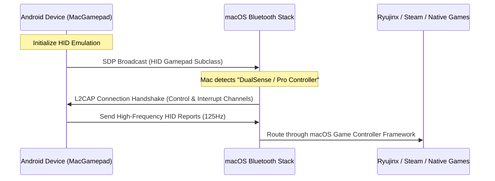

# MacGamepad

[简体中文](README.md) | **English**

Turn any Android device into a low-latency, hardware-level Bluetooth HID controller for macOS. No host-side configuration or client software required.

[](https://kotlinlang.org)
[](https://developer.android.com)
[](https://apple.com)
[](LICENSE)

Unlike virtual gamepads that rely on Wi-Fi communication and desktop helper daemons, MacGamepad operates at the native hardware level. By leveraging the Android Bluetooth HID (Human Interface Device) profile, your phone broadcasts directly to your Mac as an official game controller, making it instantly compatible with macOS, Steam, Ryujinx, RetroArch, and native games.

---

## Core Features

* **Hardware-Level Emulation**: Registers directly with macOS as a standard Bluetooth controller. Supports three console profiles:
  * **Sony DualSense** (PS5 Wireless Controller) — Symmetric analogs, virtual touchpad interface.
  * **Xbox Wireless Controller** — Staggered analogs, standard face cluster.
  * **Nintendo Switch Pro Controller** — High-precision staggered analog layout with Switch-accurate mappings.
* **Interactive Layout Customizer**: Drag, scale, and reposition any control element (sticks, D-pads, shoulder triggers, and system buttons) directly on the screen. Coordinate states are stored independently per controller profile.
* **Low-Latency Input Calibration**:
  * Runs a highly responsive 125Hz report loop.
  * **Anti-Drift Release Bypass**: Real-time throttling prevents Bluetooth queue saturation, while critical "release" events (returning sticks to zero or releasing buttons) instantly bypass throttling gates.
* **Keyboard HID Mode**: Directly maps on-screen controls to Ryujinx and Astris default keyboard configurations.
* **Instant Reconnect**: The host you last connected to is remembered in `SharedPreferences`, and the next launch registers the HID app and dials it without any tapping — no *Initialize*, no discoverability prompt for a host that already knows the phone — landing directly on the pad if that's where you left off (profile and selected macro included), or on the dashboard otherwise. Any manual pick cancels the automatic attempt, a deliberate *Disconnect* is never undone behind your back, and a failure surfaces as a one-tap retry instead of a silent spinner.
* **Macro Button**: One extra on-screen key that replays a scripted sequence of the existing buttons (hold ZL and tap A three times, mash A, B into X). The macro runs entirely on the phone — the HID descriptor, report length and button bitmap stay untouched, so the host never needs re-pairing or rebinding. Tap to fire, long-press to open the macro picker.
* **Macro Editor**: Build your own scripts without touching code. A macro is a *timeline*, not a tape: every row is one press that owns a window on the clock — when it goes down, how long it stays down — and any combination of face buttons, shoulders, triggers, D-pad, stick clicks, system keys and stick directions can be held inside it. Windows are free to overlap, which is what makes "hold ZL, press X while it is still down, then A" a two-row script instead of a dozen copies of ZL; overlapping presses are merged into one report on the phone, which is also how a chord such as Y+B lands in a single frame. A bar strip at the top draws the whole timeline, and each press has a start slider, a length slider and ±1 tick buttons for the 16 ms decisions. Under the strip sits a bulk nudge rail (整批 −200/−40/+40/+200 ms) that slides every press at once — spacing preserved, clamping at either end — so adding a lead-in never means dragging a dozen rows by hand. Its 「选择」 mode ticks individual rows (tap the row, its bar lights up blue on the strip and the others dim) and the same four buttons then move only those presses, keeping their spacing among themselves; 「完成」 leaves the mode. Each press also chooses how it behaves inside its own window: **按住** keeps the buttons down for the whole window, **连击** repeats them on a burst/gap rhythm — so mashing A through a dialogue is one turbo row showing 「16ms 按 / 16ms 停 · ×5」 instead of twenty hand-placed taps, and the strip draws the taps it will actually send. Presses can be copied, stacked on the same start, inserted into the middle of a hold, extended to the next press or deleted; the trailing cooldown releases everything so no button can stick. Built-ins can be edited and restored to factory steps; your own macros — recorded ones included — can be created, copied and deleted. The macro sheet itself is one list plus a single footer row — **录制 / 新建宏 / 编辑** — so the list keeps the whole middle of the screen on a landscape phone. **编辑** switches it into manage mode, where each row grows a trash can (a reset arrow for built-ins, whose delete means "restore factory steps"); tapping it asks once inline, in the row, before anything is removed. Everything is persisted as JSON in `SharedPreferences` (`macro_defs_v1`), older sequential files are migrated on load, and the editor can fire the unsaved draft straight at the Mac to check timing. Ships with five templates: ZL long-press + A×3, ZL long-press + X → A, **YB 复制** (Y and B in one report — the two keys must be sampled on the same frame or the game reads them as separate presses), mash A, and B into X.
* **Haptics**: Calibrate custom haptic feedback strength or receive vibration commands sent from the Mac host.
* **Macro Recording**: Long-press the macro button → 录制新宏, then just play. The service samples the reports the host actually received, one 8 ms tick at a time, and the take becomes a macro when you hit Stop (or after 12 s, whichever comes first). The macro button turns red and shows the elapsed time while recording, and a small pill carries Stop and Discard. The take is re-cut per control rather than per frame, so "ZL held for 300 ms with X tapped inside it" comes back as a 300 ms ZL bar with a 24 ms X bar nested in it — two rows you can drag, not forty frames to edit by hand. A stretch of four or more evenly spaced taps of the same button is folded into a single **连击** row automatically (drift of a tick in either the tap or the gap is tolerated), which keeps a recorded mash to one editable line; flip it back to 按住 if that is not what you meant. Captured detail is deliberately coarse — triggers are on/off and stick axes snap to a quarter — so a still thumb doesn't produce hundreds of one-tick presses; idle lead-in and tail are trimmed and single-tick runs are padded to the 16 ms floor the host needs. The result is saved as 「录制 N」, selected, and opens in the same editor as any other macro (long-press the macro button → ✎). Nothing extra is sent while recording, so the game behaves exactly as if you were simply playing.

---

## Controller Profiles

| Emulated Profile | Layout Geometry | Buttons | Input Calibrations | Native Mapped Target |
| :--- | :--- | :---: | :---: | :--- |
| **Sony DualSense** | Symmetric | 16 | Touchpad (Click + Mouse Track) | PS Remote Play, Steam |
| **Xbox Wireless** | Staggered | 15 | Xbox Logo Guide Button | Native macOS Games |
| **Nintendo Switch** | Staggered | 15 | Dynamic layout translation | Ryujinx, Astris |

---

## Connection Flow



---

## Technical Details

### SDP Descriptor Registration
MacGamepad defines a custom HID report descriptor matching console specifications. This descriptor is registered with the Android Bluetooth stack when initializing the SDP record. macOS interprets the incoming reports as native hardware events:

```kotlin
// Packets are formatted into a standard 16-bit bitmask in InputModel.kt
fun buttonBitmask(): Int {
    var mask = 0
    if (buttonB) mask = mask or (1 shl 0)   // usage 1  B (down)
    if (buttonA) mask = mask or (1 shl 1)   // usage 2  A (right)
    if (buttonY) mask = mask or (1 shl 3)   // usage 4  Y (left)
    if (buttonX) mask = mask or (1 shl 4)   // usage 5  X (up)
    // ... laid out in Switch usage order, not Xbox A/B/X/Y
    return mask
}
```

### High-Frequency Low-Latency Loop
The Bluetooth HID service runs a loop executing every **8ms (125Hz)**. Joystick inputs undergo deadzone threshold filtering and exponential response-curve scaling to offer precision aiming matching hardware controllers.

### Transition-Priority Throttling
To guarantee zero-input drift without choking the Bluetooth queue:
* Standard continuous events (sliding analogs) are throttled to run within the 8ms window.
* Release events (returning joysticks to center, or releasing pressed buttons) immediately trigger transmission, preventing values from getting "stuck" due to dropped network frames.

---

## Setup & Installation

### 1. Build and Install
```bash
git clone https://github.com/Raheedpasha10/Controller.git
cd Controller/android
./gradlew assembleDebug
```
Install the generated `app-debug.apk` directly on an Android 9+ device.

### 2. Pairing
1. Open the app and select your emulated profile.
2. Tap **Initialize**.
3. On your Mac, go to **System Settings > Bluetooth**, locate your phone under *Other Devices*, and pair.

From then on the app remembers the host it last connected to. On every later launch it registers the HID profile and dials that Mac by itself — no *Initialize* tap, no discoverability dialog, no re-pairing — and lands on the screen you left off on: the virtual pad (same profile, same selected macro) if that is where you were, the dashboard otherwise. So a cold start is phone up → pad on screen, with nothing to tap. If the Mac is off, asleep or out of range, the connection screen says so after ~9 s and offers a one-tap **Retry** plus the manual list. Picking a device by hand cancels the automatic attempt, **Disconnect** is respected (it won't be silently undone on resume), and the behaviour can be switched off in **Settings → 连接 → 自动重连**. A link that drops while the app is in the background is re-dialled on return and puts you back on the pad.

### 3. Configuration
* Navigate to your emulator or game input settings (such as Ryujinx or Steam).
* The emulator will automatically detect your phone as a hardware gamepad (e.g. `DualSense Wireless Controller`).
* Bind the buttons accordingly.

---

## Troubleshooting

### Connection drop or timeout
Ensure your phone is not paired to other active hosts. Unpair the phone from your Mac's Bluetooth history and pair it again from scratch. Toggling the phone's Bluetooth on and off resolves transient HID service binding errors.

### Joystick deflection issues
Go to **Settings** in the app. Use the **Stick Sensitivity** slider to adjust amplification (50% to 200%), or increase the **Dead Zone** setting (5% to 35%) to filter out accidental drift or thumb jitter.

### Face buttons swapped (A/B)
Ryujinx and other Switch emulators expect the physical button layouts of a Switch controller. Ensure you are using the **Nintendo Switch Pro** profile. The A/B and X/Y layout mapping translation will route index outputs to default emulator layouts.

---

## License
This project is licensed under the MIT License — see the [LICENSE](LICENSE) file for details.
