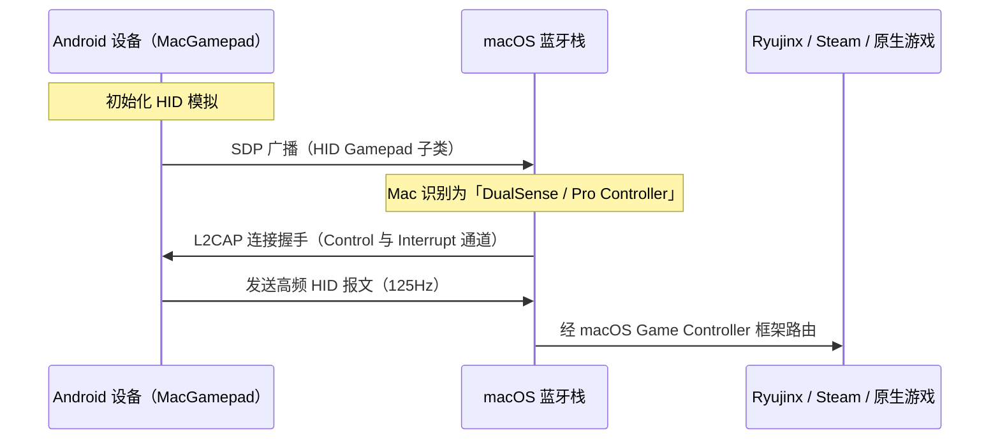

# MacGamepad

**简体中文** | [English](README.en.md)

把任意一台 Android 设备变成 macOS 上的低延迟、硬件级蓝牙 HID 手柄。主机侧不需要任何配置，也不需要安装客户端软件。

[](https://kotlinlang.org)
[](https://developer.android.com)
[](https://apple.com)
[](LICENSE)

与那些依赖 Wi-Fi 通信和桌面端守护进程的虚拟手柄不同，MacGamepad 工作在原生硬件层。它利用 Android 的蓝牙 HID（Human Interface Device）规范，让手机直接以官方手柄的身份向 Mac 广播，因此可以立即被 macOS、Steam、Ryujinx、RetroArch 以及原生游戏识别。

---

## 核心特性

* **硬件级模拟**：直接以标准蓝牙手柄的身份在 macOS 注册。支持三种主机档案：
  * **Sony DualSense**（PS5 无线手柄）——对称双摇杆，含虚拟触摸板接口。
  * **Xbox 无线手柄**——错位双摇杆，标准面键布局。
  * **Nintendo Switch Pro 手柄**——高精度错位摇杆布局，按键映射与 Switch 对齐。
* **可视化布局定制**：可直接在屏幕上拖拽、缩放、移动任意控件（摇杆、十字键、肩键扳机、系统键），坐标状态按手柄档案分别独立保存。
* **低延迟输入校准**：
  * 采用高响应的 125Hz 报文循环。
  * **防漂移释放直通**：实时限流可避免蓝牙队列拥塞，而关键的「释放」事件（摇杆回中、按键抬起）会立即绕过限流闸门。
* **键盘 HID 模式**：把屏幕控件直接映射为 Ryujinx 与 Astris 的默认键盘配置。
* **立即重连**：上次连接的主机会记在 `SharedPreferences` 里，下次启动时自动注册 HID 应用并主动拨号——无需点击 *Initialize*，也不会对着已知主机再弹一次可发现性提示。如果上次停在虚拟手柄页，就直接落到手柄页（档案与选中的宏一并恢复），否则落在首页。任何手动选择都会取消自动尝试；主动点过 *Disconnect* 绝不会被悄悄撤销；失败时给出一键重试，而不是默默转圈。
* **宏按键**：在屏幕上多出一颗键，可回放由现有按键编成的脚本（按住 ZL 连点 A 三下、连打 A、B 接 X）。宏完全在手机端执行——HID 描述符、报文长度与按键位图都不变，所以主机侧永远不需要重新配对或重新绑定。点按即触发，长按打开宏选择器。
* **宏编辑器**：不写代码也能编脚本。

  宏是**时间轴**，不是磁带：每一行是一次按压，占用时钟上的一段窗口——什么时候按下、按住多久——窗口内可以同时按住面键、肩键、扳机、十字键、摇杆按下、系统键和摇杆方向的任意组合。窗口允许自由重叠，正因如此「按住 ZL，在它还没松时按 X，然后再按 A」只需要两行脚本，而不是把 ZL 复制十几遍；重叠的按压在手机端会合并成一条报文，像 Y+B 这样的组合键也正是靠这一点在同一帧落下去。

  顶部的条带会画出整条时间轴，每次按压都有起始滑块、长度滑块和 ±1 tick 微调按钮，用来做 16ms 级别的取舍。条带下方是一条整批推移轨道（整批 −200/−40/+40/+200 ms），一次性平移所有按压——间距保持不变，两端自动夹紧——所以加一个前摇不必再靠手一行行拖。它的「选择」模式可勾选单行（点该行，条带上它的色块变蓝、其余变暗），此时同样那四个按钮只移动被选中的按压，且它们彼此的间距保持不变；「完成」退出该模式。

  每次按压还可以各自选择在自己的窗口内如何表现：**按住**会在整段窗口内保持按下，**连击**则按「爆发/间隔」的节奏重复——于是对话中点打 A 只需一行 turbo，显示「16ms 按 / 16ms 停 · ×5」，而不必手放二十个点；条带会画出它实际将要发出的每一次点按。按压可以复制、叠到同一起点、插入到某个长按的中间、延长到下一次按压，或删除；末尾的冷却段会释放全部按键，确保没有键会卡住。

  内置宏可以编辑，也可以恢复出厂步骤；自建宏（含录制出来的）可以新建、复制、删除。宏面板本身是一个列表加一行页脚——**录制 / 新建宏 / 编辑**——这样在横屏手机上，列表能占满整个屏幕中段。**编辑**会把面板切到管理模式，每行出现一个垃圾桶图标（内置宏是还原箭头，其「删除」意味着「恢复出厂步骤」）；点击时会在该行内就地确认一次，然后才真正移除。所有内容以 JSON 存进 `SharedPreferences`（`macro_defs_v1`），旧版按序号分散的文件会在加载时迁移；编辑器也可以把尚未保存的草稿直接发给 Mac 试时序。出厂自带五套模板：ZL 长按 + A×3、ZL 长按 + X → A、**YB 复制**（Y 与 B 在同一份报文里——两个键必须在同一帧被采样，否则游戏会读成两次独立按压）、连打 A、B 接 X。
* **触感反馈**：可校准自定义振动强度，也可以接收 Mac 主机下发的振动指令。
* **宏录制**：长按宏按键 → 录制新宏，然后照常玩即可。服务端会以 8ms 为一 tick，采样主机**实际收到**的报文，点停止（或满 12 秒，以先到者为准）后这次采样就成为一条宏。录制期间宏按键变红并显示已用时间，另有一枚小胶囊承载停止与丢弃。采样是按控件而非按帧重新切分的，所以「ZL 按住 300ms、其间点了一下 X」回来是「300ms 的 ZL 条 + 内嵌 24ms 的 X 条」两行，可以拖动，而不是四十帧等着手动改。同一按键出现连续四次以上等间隔点按时，会自动折叠成单独一行**连击**（点按或间隔有一个 tick 的偏差也能容忍），这样录出来的一串连打只需要一行就能编辑；如果不是你想要的，切回**按住**即可。捕获的精度是有意做粗的——扳机只分按下/未按下，摇杆轴对齐到四分之一——以免拇指不动却产生上百个单 tick 按压；开头的空闲与结尾的多余会被裁掉，单 tick 的连续段会补齐到主机所需的 16ms 下限。结果保存为「录制 N」并被选中，之后和其他宏一样在同一个编辑器里打开（长按宏按键 → ✎）。录制过程中不会额外发送任何东西，所以游戏的表现和你在正常游玩时完全一样。

---

## 手柄档案

| 模拟档案 | 布局几何 | 按键数 | 输入校准 | 原生映射目标 |
| :--- | :--- | :---: | :---: | :--- |
| **Sony DualSense** | 对称 | 16 | 触摸板（点击 + 鼠标轨迹） | PS Remote Play、Steam |
| **Xbox 无线** | 错位 | 15 | Xbox Logo Guide 键 | macOS 原生游戏 |
| **Nintendo Switch** | 错位 | 15 | 动态布局换算 | Ryujinx、Astris |

---

## 连接流程



---

## 技术细节

### SDP 描述符注册
MacGamepad 定义了一份符合主机规范的 HID 报文描述符，并在初始化 SDP 记录时把它注册到 Android 蓝牙栈。macOS 会把收到的报文当作原生硬件事件来解析：

```kotlin
// 报文在 InputModel.kt 中被格式化为标准的 16 位位图
fun buttonBitmask(): Int {
    var mask = 0
    if (buttonB) mask = mask or (1 shl 0)   // usage 1  B（下）
    if (buttonA) mask = mask or (1 shl 1)   // usage 2  A（右）
    if (buttonY) mask = mask or (1 shl 3)   // usage 4  Y（左）
    if (buttonX) mask = mask or (1 shl 4)   // usage 5  X（上）
    // ... 按 Switch 的 usage 排布落位，而非 Xbox 的 A/B/X/Y
    return mask
}
```

### 高频低延迟循环
蓝牙 HID 服务以 **8ms（125Hz）** 为周期运行。摇杆输入会经过死区阈值过滤与指数响应曲线缩放，以获得可与硬件手柄相当的精确瞄准手感。

### 优先级限流
为了在不堵塞蓝牙队列的前提下保证零输入漂移：
* 常规连续事件（摇杆滑动）被限制在 8ms 窗口内发送。
* 释放事件（摇杆回中、按键抬起）立即触发发送，避免数值因丢帧而「卡住」。

---

## 安装与使用

### 1. 编译与安装
```bash
git clone https://github.com/Raheedpasha10/Controller.git
cd Controller/android
./gradlew assembleDebug
```

把生成的 `app-debug.apk` 直接安装到 Android 9 及以上设备。

### 2. 配对
1. 打开 App，选择要模拟的手柄档案。
2. 点 **Initialize**。
3. 在 Mac 上打开 **系统设置 > 蓝牙**，在*其他设备*中找到你的手机并配对。

此后 App 会记住上一次连接的主机。之后每次启动，它都会自行注册 HID 档案并拨号那台 Mac——不用点 *Initialize*，不会弹可发现性对话框，也不需要重新配对——并直接落到你上次离开的界面：如果当时在虚拟手柄页，就回到手柄页（同一档案、同一个选中的宏），否则回到首页。所以冷启动就是「拿起手机 → 手柄页已在屏幕上」，无需任何点击。如果 Mac 关机、休眠或超出范围，连接界面会在约 9 秒后说明情况，并提供一键 **重试** 以及手动列表。手动选择设备会取消自动尝试，**断开连接** 会被尊重（恢复前台时不会悄悄重连），这一行为可在 **设置 → 连接 → 自动重连** 中关闭。若 App 在后台期间链路掉线，回到前台时会重新拨号并把你送回手柄页。

### 3. 配置
* 进入模拟器或游戏的输入设置（例如 Ryujinx 或 Steam）。
* 模拟器会自动把手机识别为硬件手柄（例如 `DualSense Wireless Controller`）。
* 按需绑定按键即可。

---

## 故障排查

### 连接断开或超时
确认手机没有同时配对到其他活跃主机。在 Mac 的蓝牙历史里删除该手机，再从头配对一次。把手机蓝牙关掉再打开，可以解决临时的 HID 服务绑定错误。

### 摇杆偏移异常
进入 App 的 **设置**。用 **摇杆灵敏度** 滑块调整放大量（50% 到 200%），或调高 **死区**（5% 到 35%），以过滤意外漂移或拇指抖动。

### 面键 A/B 反了
Ryujinx 等 Switch 模拟器期望的是 Switch 手柄的物理按键布局。请确认使用的是 **Nintendo Switch Pro** 档案。A/B 与 X/Y 的布局换算会把索引输出路由到模拟器的默认布局。

---

## 许可
本项目采用 MIT 许可——详见 [LICENSE](LICENSE) 文件。
