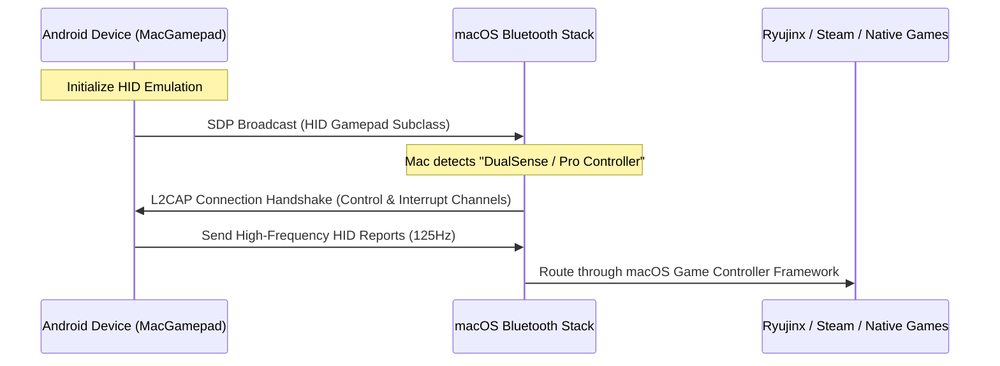

# MacGamepad

Turn any Android device into a low-latency, hardware-level Bluetooth HID controller for macOS. No host-side configuration or client software required.

[](https://kotlinlang.org)
[](https://developer.android.com)
[](https://apple.com)
[](LICENSE)

Unlike virtual gamepads that rely on Wi-Fi communication and desktop helper daemons, MacGamepad operates at the native hardware level. By leveraging the Android Bluetooth HID (Human Interface Device) profile, your phone broadcasts directly to your Mac as an official game controller, making it instantly compatible with macOS, Steam, Ryujinx, RetroArch, and native games.

---

## Core Features

* **Hardware-Level Emulation**: Registers directly with macOS as a standard Bluetooth controller. Supports three console profiles:
  * **Sony DualSense** (PS5 Wireless Controller) — Symmetric analogs, virtual touchpad interface.
  * **Xbox Wireless Controller** — Staggered analogs, standard face cluster.
  * **Nintendo Switch Pro Controller** — High-precision staggered analog layout with Switch-accurate mappings.
* **Interactive Layout Customizer**: Drag, scale, and reposition any control element (sticks, D-pads, shoulder triggers, and system buttons) directly on the screen. Coordinate states are stored independently per controller profile.
* **Low-Latency Input Calibration**:
  * Runs a highly responsive 125Hz report loop.
  * **Anti-Drift Release Bypass**: Real-time throttling prevents Bluetooth queue saturation, while critical "release" events (returning sticks to zero or releasing buttons) instantly bypass throttling gates.
* **Keyboard HID Mode**: Directly maps on-screen controls to Ryujinx and Astris default keyboard configurations.
* **Haptics**: Calibrate custom haptic feedback strength or receive vibration commands sent from the Mac host.

---

## Controller Profiles

| Emulated Profile | Layout Geometry | Buttons | Input Calibrations | Native Mapped Target |
| :--- | :--- | :---: | :---: | :--- |
| **Sony DualSense** | Symmetric | 16 | Touchpad (Click + Mouse Track) | PS Remote Play, Steam |
| **Xbox Wireless** | Staggered | 15 | Xbox Logo Guide Button | Native macOS Games |
| **Nintendo Switch** | Staggered | 15 | Dynamic layout translation | Ryujinx, Astris |

---

## Connection Flow



---

## Technical Details

### SDP Descriptor Registration
MacGamepad defines a custom HID report descriptor matching console specifications. This descriptor is registered with the Android Bluetooth stack when initializing the SDP record. macOS interprets the incoming reports as native hardware events:

```kotlin
// Packets are formatted into a standard 16-bit bitmask in InputModel.kt
fun buttonBitmask(): Int {
    var mask = 0
    if (buttonA) mask = mask or (1 shl 0)
    if (buttonB) mask = mask or (1 shl 1)
    if (buttonX) mask = mask or (1 shl 2)
    if (buttonY) mask = mask or (1 shl 3)
    // ... maps to standard OS controller bits
    return mask
}
```

### High-Frequency Low-Latency Loop
The Bluetooth HID service runs a loop executing every **8ms (125Hz)**. Joystick inputs undergo deadzone threshold filtering and exponential response-curve scaling to offer precision aiming matching hardware controllers.

### Transition-Priority Throttling
To guarantee zero-input drift without choking the Bluetooth queue:
* Standard continuous events (sliding analogs) are throttled to run within the 8ms window.
* Release events (returning joysticks to center, or releasing pressed buttons) immediately trigger transmission, preventing values from getting "stuck" due to dropped network frames.

---

## Setup & Installation

### 1. Build and Install
```bash
git clone https://github.com/Raheedpasha10/Controller.git
cd Controller/android
./gradlew assembleDebug
```
Install the generated `app-debug.apk` directly on an Android 9+ device.

### 2. Pairing
1. Open the app and select your emulated profile.
2. Tap **Initialize**.
3. On your Mac, go to **System Settings > Bluetooth**, locate your phone under *Other Devices*, and pair.

### 3. Configuration
* Navigate to your emulator or game input settings (such as Ryujinx or Steam).
* The emulator will automatically detect your phone as a hardware gamepad (e.g. `DualSense Wireless Controller`).
* Bind the buttons accordingly.

---

## Troubleshooting

### Connection drop or timeout
Ensure your phone is not paired to other active hosts. Unpair the phone from your Mac's Bluetooth history and pair it again from scratch. Toggling the phone's Bluetooth on and off resolves transient HID service binding errors.

### Joystick deflection issues
Go to **Settings** in the app. Use the **Stick Sensitivity** slider to adjust amplification (50% to 200%), or increase the **Dead Zone** setting (5% to 35%) to filter out accidental drift or thumb jitter.

### Face buttons swapped (A/B)
Ryujinx and other Switch emulators expect the physical button layouts of a Switch controller. Ensure you are using the **Nintendo Switch Pro** profile. The A/B and X/Y layout mapping translation will route index outputs to default emulator layouts.

---

## License
This project is licensed under the MIT License — see the [LICENSE](LICENSE) file for details.
